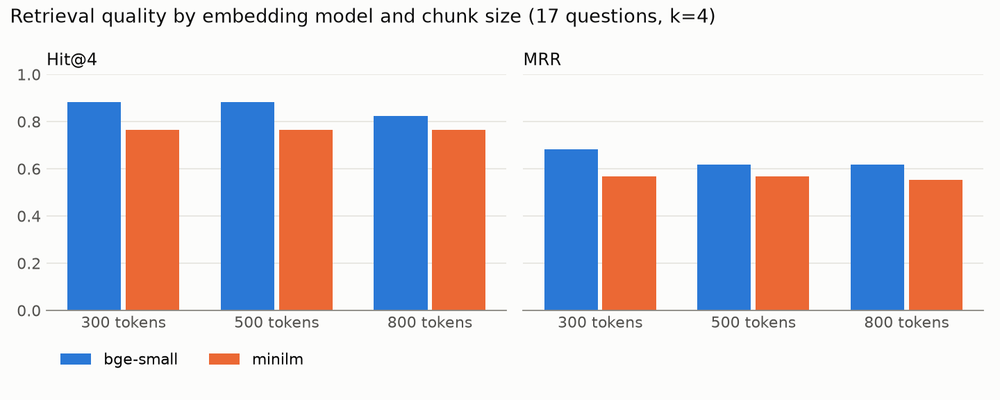

# PaperRAG

Question answering over my own research papers. A question is embedded, the most relevant page chunks are retrieved from a FAISS index, and an open-source LLM (Llama 3.2 3B, served locally by Ollama) answers **only from those chunks**, citing paper and page. If the papers don't contain the answer, it says so.

The three papers:
1. *Sarcasm Detection in Social Media Text* (BoW/TF-IDF + Naive Bayes, Logistic Regression, SVM)
2. *Bitcoin Price Direction Prediction* (XGBoost, LSTM, FinBERT, SHAP)
3. *Emotion Detection: Classical ML vs Transformers* (BERT, DistilBERT, ensemble on CARER and DailyDialog)

> Setup steps, architecture diagram and demo screenshot are coming in the next update.

## Benchmark

I wrote 20 questions by hand from the papers ([eval/questions.json](eval/questions.json)): 17 with a known answer and the pages where it appears, and 3 that the system should refuse (one off-topic, one about a model that was never tested, and one near-miss trap whose answer appears in a *different* paper).

Six retrieval setups were compared: 2 embedding models × 3 chunk sizes (overlap 20% of chunk size, top k = 4, exact cosine search).

- **Hit@k**: share of questions where a correct page is in the top k chunks
- **MRR**: mean reciprocal rank of the first correct chunk (rewards finding it at rank 1 over rank 4)

### Retrieval

| Embedding model | Chunk size | Hit@1 | Hit@4 | MRR | Chunks truncated by the model |
|---|---|---|---|---|---|
| **bge-small-en-v1.5** | **300** | **0.53** | **0.88** | **0.68** | 0% |
| bge-small-en-v1.5 | 500 | 0.47 | 0.88 | 0.62 | 0% |
| bge-small-en-v1.5 | 800 | 0.47 | 0.82 | 0.62 | 46% |
| all-MiniLM-L6-v2 | 300 | 0.47 | 0.77 | 0.57 | 73% |
| all-MiniLM-L6-v2 | 500 | 0.41 | 0.77 | 0.57 | 85% |
| all-MiniLM-L6-v2 | 800 | 0.41 | 0.77 | 0.55 | 88% |

### Answers (Llama 3.2 3B)

| Retrieval setup | Answer accuracy | Cites a correct page | Correct refusals | False refusals | Mean time per answer |
|---|---|---|---|---|---|
| bge-small, 300 | 0.65 (11/17) | 0.82 | 3/3 | 0 | 92 s |
| bge-small, 500 | 0.71 (12/17) | 0.76 | 3/3 | 1 | 139 s |

Times are on a CPU-only laptop (Intel i5-1135G7, 8 GB RAM). Per-question results are in [eval/results/](eval/results/).

### Findings

- **bge-small beats MiniLM at every chunk size**, most clearly on ranking (MRR 0.62–0.68 vs 0.55–0.57). MiniLM reads at most 256 tokens, so it embeds only the start of 73–88% of the chunks.
- **Chunk size matters little for bge** (Hit@4 0.82–0.88). 800-token chunks exceed bge's 512-token limit and are partly truncated, so they never help.
- **Retrieval sets the ceiling, and the small LLM loses some answers even after a correct retrieval.** Answer accuracy (0.65–0.71) sits below Hit@4 (0.88). Failures fall into three groups:
  - *Retrieval miss:* the most dangerous case. For the LSTM recall question the right table was not retrieved, and the model produced a confident, cited, wrong number. With the 500 setup, a different miss was handled correctly with "I don't know".
  - *Table misreading:* tables are extracted as long rows of numbers, and the model picked values from neighbouring columns.
  - *Reasoning errors:* asked for the **worst** classical model, it named the best one.
- **Refusal works.** All 3 refusal questions were answered "I don't know", including the near-miss trap.

### Limitations

- 17 answerable questions means each question is worth about 6 points. The two bge setups differ by one question in answer accuracy, which is not a meaningful difference; the bge-vs-MiniLM gap is consistent across all sizes.
- Answer correctness is a "contains the key facts" check. It is lenient: an answer can contain the right number while getting other details wrong.
- After the first run I corrected two page labels whose facts also appear on another page (B4: page 7; E5: the code appendix on page 12). No questions or answers were changed.
