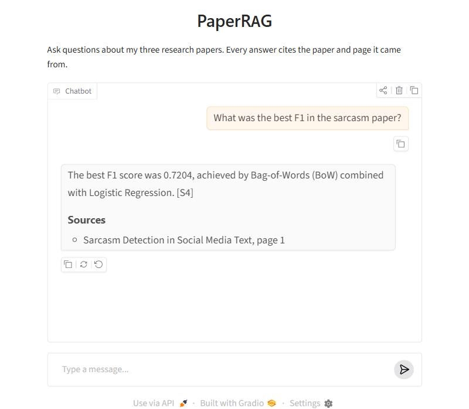
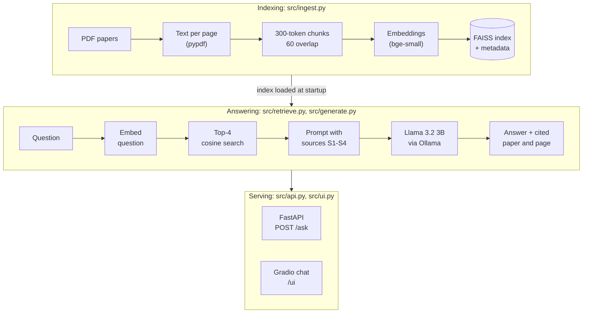

# PaperRAG

[](https://github.com/FayazAbrar20/paper-rag/actions/workflows/tests.yml)

Question answering over research papers I co-authored. A question is embedded, the most relevant page chunks are retrieved from a FAISS index, and an open-source LLM (Llama 3.2 3B, served locally by Ollama) answers **only from those chunks**, citing paper and page. If the papers don't contain the answer, it says so.

Everything runs locally on a CPU-only laptop: no API keys, no cloud, no cost per question.



The three papers (in [data/papers/](data/papers/)):
1. *Sarcasm Detection in Social Media Text* (BoW/TF-IDF + Naive Bayes, Logistic Regression, SVM)
2. *Bitcoin Price Direction Prediction* (XGBoost, LSTM, FinBERT, SHAP)
3. *Emotion Detection: Classical ML vs Transformers* (BERT, DistilBERT, ensemble on CARER and DailyDialog)

## How it works



Design decisions:
- **Chunks never cross a page boundary**, so every citation points to an exact page.
- **Chunk size is counted in the embedding model's own tokens**, not words, so it can be matched to the model's input limit (512 tokens for bge-small, 256 for MiniLM).
- **Sources are labelled `[S1]`–`[S4]`.** My first version used `[1]`–`[4]`, and the model confused them with the papers' own reference markers like `[5]`, citing sources that didn't exist.
- **The prompt defines an exact refusal sentence**, so "refused when it should" can be measured.
- **Temperature 0 and an explicit 4096-token context window**: answers are reproducible for the benchmark, and Ollama never silently cuts off part of the prompt.
- **API and UI run in one process**: the Gradio chat is mounted inside the FastAPI app, so the models are loaded once. On an 8 GB laptop a second process would duplicate about 1 GB of model memory.
- **The 300-token chunk size was chosen by the benchmark below**: better ranking than 500 tokens, and about a third faster per answer because the prompt is smaller.

## Benchmark

I wrote 20 questions by hand from the papers ([eval/questions.json](eval/questions.json)): 17 with a known answer and the pages where it appears, and 3 that the system should refuse (one off-topic, one about a model that was never tested, and one near-miss trap whose answer appears in a *different* paper).

Six retrieval setups were compared: 2 embedding models × 3 chunk sizes (overlap 20% of chunk size, top k = 4, exact cosine search).

- **Hit@k**: share of questions where a correct page is in the top k chunks
- **MRR**: mean reciprocal rank of the first correct chunk (rewards finding it at rank 1 over rank 4)

### Retrieval

| Embedding model | Chunk size | Hit@1 | Hit@4 | MRR | Chunks truncated by the model |
|---|---|---|---|---|---|
| **bge-small-en-v1.5** | **300** | **0.53** | **0.88** | **0.68** | 0% |
| bge-small-en-v1.5 | 500 | 0.47 | 0.88 | 0.62 | 0% |
| bge-small-en-v1.5 | 800 | 0.47 | 0.82 | 0.62 | 46% |
| all-MiniLM-L6-v2 | 300 | 0.47 | 0.77 | 0.57 | 73% |
| all-MiniLM-L6-v2 | 500 | 0.41 | 0.77 | 0.57 | 85% |
| all-MiniLM-L6-v2 | 800 | 0.41 | 0.77 | 0.55 | 88% |


### Answers (Llama 3.2 3B)

| Retrieval setup | Answer accuracy | Cites a correct page | Correct refusals | False refusals | Mean time per answer |
|---|---|---|---|---|---|
| bge-small, 300 | 0.65 (11/17) | 0.82 | 3/3 | 0 | 92 s |
| bge-small, 500 | 0.71 (12/17) | 0.76 | 3/3 | 1 | 139 s |

Times are on a CPU-only laptop (Intel i5-1135G7, 8 GB RAM). Per-question results are in [eval/results/](eval/results/).

### Findings

- **bge-small beats MiniLM at every chunk size**, most clearly on ranking (MRR 0.62–0.68 vs 0.55–0.57). MiniLM reads at most 256 tokens, so it embeds only the start of 73–88% of the chunks.
- **Chunk size matters little for bge** (Hit@4 0.82–0.88). 800-token chunks exceed bge's 512-token limit and are partly truncated, so they never help.
- **Retrieval sets the ceiling, and the small LLM loses some answers even after a correct retrieval.** Answer accuracy (0.65–0.71) sits below Hit@4 (0.88). Failures fall into three groups:
  - *Retrieval miss:* the most dangerous case. For the LSTM recall question the right table was not retrieved, and the model produced a confident, cited, wrong number. With the 500 setup, a different miss was handled correctly with "I don't know".
  - *Table misreading:* tables are extracted as long rows of numbers, and the model picked values from neighbouring columns.
  - *Reasoning errors:* asked for the **worst** classical model, it named the best one.
- **Refusal works.** All 3 refusal questions were answered "I don't know", including the near-miss trap.

### Limitations

- 17 answerable questions means each question is worth about 6 points. The two bge setups differ by one question in answer accuracy, which is not a meaningful difference; the bge-vs-MiniLM gap is consistent across all sizes.
- Answer correctness is a "contains the key facts" check. It is lenient: an answer can contain the right number while getting other details wrong.
- After the first run I corrected two page labels whose facts also appear on another page (B4: page 7; E5: the code appendix on page 12). No questions or answers were changed.

## Setup (Windows, PowerShell)

Requirements: [Python 3.11](https://www.python.org/downloads/), [Ollama](https://ollama.com/download), Git, and about 8 GB of RAM.

```powershell
git clone https://github.com/FayazAbrar20/paper-rag.git
cd paper-rag
py -3.11 -m venv .venv
.\.venv\Scripts\python.exe -m pip install -r requirements.txt
ollama pull llama3.2:3b
```

On Linux or macOS, use `python3.11 -m venv .venv` and `.venv/bin/python`. On Linux, install the CPU-only build of torch first (`pip install torch==2.15.0 --index-url https://download.pytorch.org/whl/cpu`) to avoid downloading the much larger GPU build.

Build the index (downloads bge-small on first run, about 130 MB):
```powershell
.\.venv\Scripts\python.exe src\ingest.py
```

Start the API and chat UI:
```powershell
.\.venv\Scripts\python.exe src\api.py
```
- Chat: http://127.0.0.1:8000/ui
- Interactive API docs: http://127.0.0.1:8000/docs
- `GET /health` checks the index and Ollama; `POST /ask` with `{"question": "..."}` returns `{"answer", "sources"}`.

Ask from the command line instead:
```powershell
.\.venv\Scripts\python.exe src\generate.py "What was the best F1 in the sarcasm paper?"
```

Re-run the benchmark (retrieval takes minutes; answers take one LLM call per question and resume if interrupted):
```powershell
.\.venv\Scripts\python.exe eval\run_eval.py retrieval
.\.venv\Scripts\python.exe eval\run_eval.py answers --configs bge-small_300 bge-small_500
```

To use your own PDFs, put them in `data/papers/` and rebuild the index. Paper names come from the `PAPERS` mapping in `src/ingest.py` (otherwise the file name is used).

## Tests

25 unit tests cover:
- citation parsing: only `[S1]`–`[S4]` count, never the papers' own `[5]`-style references; duplicate pages are merged; a refusal has no sources;
- refusal detection and the prompt's source labels;
- page chunking: size, overlap, the last chunk ending at the page end, no text skipped;
- the API: request validation, the response shape, and a 503 when Ollama is down;
- the chat reply format.

The tests use a fake tokenizer and a stubbed LLM, so they need no model downloads and no Ollama. GitHub Actions runs them on every push.

```powershell
.\.venv\Scripts\python.exe -m pip install -r requirements-dev.txt
.\.venv\Scripts\python.exe -m pytest -q
```

## Project structure

```
data/papers/        the three PDFs
src/ingest.py       PDF → page text → token chunks → embeddings → FAISS index
src/retrieve.py     top-k search (loads the index and model once)
src/generate.py     prompt + Ollama call, returns answer and cited sources
src/api.py          FastAPI app: POST /ask, GET /health, chat UI mounted at /ui
src/ui.py           Gradio chat
eval/questions.json 20 hand-labelled benchmark questions
eval/run_eval.py    retrieval and answer benchmark, writes eval/results/
tests/              unit tests (pytest), run by .github/workflows/tests.yml
```

## What I learned

- **Measure retrieval and generation separately.** A single end-to-end accuracy would have hidden whether a failure came from search, from table extraction, or from the model's reasoning.
- **An embedding model's input limit has to match the chunk size.** Past the limit, text is silently ignored.
- **PDF tables are the weak point.** Text extraction flattens them into rows of numbers, which embed poorly and are easy for a small model to misread.
- **On 8 GB of RAM, memory is the bottleneck, not compute.** Answers took minutes when the LLM's weights were paged to disk, and seconds when they fit in memory.

## Next steps

- Hybrid search (BM25 keyword matching + vectors) for exact terms like "recall" and "split", which the vector search missed
- Table-aware PDF extraction, or keeping each table as one chunk with its caption
- A cross-encoder re-ranker on the top 10 results
- Compare `llama3.2:3b` with `llama3.2:1b` for speed against accuracy
- Dockerfile for the API, and a small agent that chooses between searching the papers and comparing numbers across them

## Credits

The papers are group projects from American International University-Bangladesh; co-authors are listed in each PDF. The code in this repository is released under the [MIT License](LICENSE); the papers are not covered by that license.
